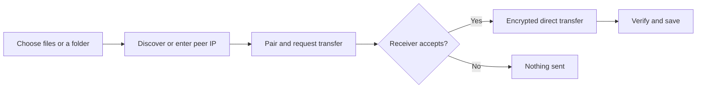
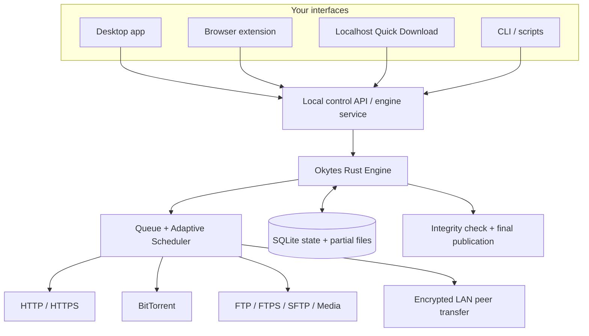
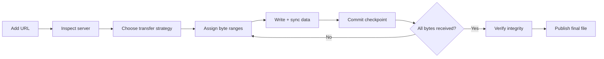

\<div align="center">

# Okytes

### A download manager built to finish what it starts.

**Fast when the connection allows it. Careful when things go wrong. Yours, completely.**

A free, open-source download manager powered by Rust, designed around adaptive transfers, dependable recovery, and one download engine that works across interfaces.

**Windows · Linux · macOS · Browser integration · FTP/SFTP · LAN sharing · CLI · Local web interface**

[Features](#everything-you-need-to-manage-downloads) · [File transfers](#ftp-ftps-and-sftp--more-than-a-download-link) · [LAN Share](#lan-share--send-files-directly-between-devices) · [Compare](#okytes-vs-idm-vs-fdm) · [Architecture](#how-okytes-works) · [Contribute](#open-source-without-an-asterisk)

\</div>

---

## Downloading should be the easy part

Big files, unreliable connections, expired links, interrupted sessions, and a dozen browser tabs. A download manager should make these problems smaller, not introduce new ones.

Okytes (ODM) brings together the convenience people expect from **Internet Download Manager (IDM)**, the flexibility associated with **Free Download Manager (FDM)**, and an architecture that puts **recoverability, integrity, privacy, and interoperability** at the center.

- **Download efficiently.** Use multiple connections when they genuinely help, rather than assuming more connections always mean more speed.

- **Continue confidently.** Restore committed progress after interruption without silently combining bytes from different versions of a file.

- **Keep files trustworthy.** Verify downloads before presenting them as completed files.

- **Work your way.** Download from the web, browse remote servers, or send files to another computer using the same familiar interface.

- **Stay in control.** No ads, subscriptions, mandatory accounts, cloud relay, or opt-out telemetry.

> **The idea:** download acceleration is useful. Knowing that the file is complete, correct, and recoverable is essential.

## Everything you need to manage downloads

### Speed without guesswork

- **Adaptive segmented transfers** — split eligible HTTP/HTTPS files into byte ranges and download sections concurrently.

- **Throughput-aware concurrency** — measure whether additional workers improve actual transfer rate before increasing parallelism.

- **Dynamic range allocation** — redistribute unfinished work without having two workers write the same bytes.

- **Connection-aware scheduling** — enforce per-server limits to avoid uncontrolled contention across downloads.

- **Retry intelligently** — back off on transient errors, honor server throttling, and avoid aggressive retry storms.

- **Bandwidth control** — tune speed and connection use around the rest of your network activity.

### Recovery you can rely on

- **Persistent queue** — keep downloads, priorities, and transfer state across restarts.

- **Crash-safe checkpoints** — record progress only after the corresponding file data has been flushed to disk.

- **Remote file identity checks** — validate the target before resuming so a replaced file cannot silently corrupt an earlier partial download.

- **Safe resume fallback** — restart conservatively when a server cannot establish a trustworthy resume point.

- **Verified completion** — calculate SHA-256, optionally compare it with a trusted expected checksum, and publish the final filename only after verification.

- **Deliberate file handling** — choose how to handle existing files instead of risking accidental overwrites.

### Downloads beyond a single URL

- **HTTP and HTTPS** for everyday files, software, archives, and large transfers.

- **BitTorrent and magnet links** for decentralized distribution.

- **FTP, FTPS, and SFTP** to browse remote directories and transfer files in both directions, with secure connections and resumable operations where supported.
- **Okytes LAN Share** to send files and folders directly between paired computers over a local network, without setting up an FTP server.

- **HLS and MPEG-DASH** for supported media workflows, without bypassing DRM or access controls.

- **Scheduling and queue priorities** to organize work around time, network availability, and user preference.

### One engine, many ways to use it

| Interface | Best for |

| --- | --- |

| **Desktop app** | A clear download dashboard, drag-and-drop workflows, history, and controls |

| **Browser extensions** | Capturing downloads while browsing and sending them to the native engine |

| **Quick Download in your browser** | Manually pasting a URL when an extension misses a download |

| **CLI** | Terminal workflows, scripts, automation, and headless systems |

| **Local daemon + API** | Background downloads and multiple clients controlling the same queue |

**No second download engine is hiding inside the UI.** The Rust core owns transfers; the interfaces simply tell it what to do.

## FTP, FTPS, and SFTP — more than a download link

Okytes treats remote servers like places you can work with, not just URLs to copy. Connect to a NAS, home server, development machine, or office file server, browse its directories, and move files in either direction.

- **Remote file explorer.** Navigate folders, inspect files and sizes, and choose exactly what to transfer.
- **Download and upload.** Move single files, batches, or directory trees between local storage and a remote server.
- **Secure connections.** Connect using SFTP over SSH or FTPS with TLS; use plain FTP only when explicitly chosen for a trusted environment.
- **Flexible authentication.** Support passwords and SSH keys for SFTP, secure credential handling, and saved connection profiles without exposing secrets in logs.
- **Queue-aware transfers.** Manage uploads and downloads alongside other Okytes jobs with progress, cancellation, retries, and sensible bandwidth limits.
- **Interrupted-transfer recovery.** Resume where the protocol, server, and remote-file identity permit it; otherwise restart safely rather than risk mixed or corrupted content.
- **File conflict controls.** Review destination collisions instead of overwriting files silently.

### Choose the right protocol

| Protocol | Connection | Best for | Security note |
| --- | --- | --- | --- |
| **FTP** | `ftp://server` | Legacy devices and servers | No built-in encryption; avoid for sensitive transfers |
| **FTPS** | `ftps://server` | FTP servers configured with TLS | Encrypts the FTP session when TLS is correctly enforced |
| **SFTP** | `sftp://server` | SSH servers, NAS devices, developer workflows | Runs over SSH; supports strong host identity checks and key-based login |

> **SFTP is not FTP over TLS.** SFTP uses SSH, while FTPS is the FTP protocol secured by TLS. Okytes keeps their authentication, connection handling, and resume semantics in separate protocol adapters.

## LAN Share — send files directly between devices

A laptop and desktop on the same network should not need cloud storage, messaging apps, or a separately configured FTP server just to exchange a project folder. With **Okytes LAN Share**, the workflow stays local.



- **Nearby-device discovery.** Find Okytes peers on the LAN using local service discovery, with manual IP and port as a fallback.
- **Send and receive.** Transfer files, multiple selections, and recursive folders directly between computers.
- **Consent by default.** Authenticate devices through pairing and require approval for incoming requests, with explicit trusted-device settings.
- **Encrypted on the wire.** Use authenticated peer sessions rather than unprotected FTP for Okytes-to-Okytes sharing.
- **Built for interruptions.** Preserve verified progress, detect changed source files, and resume safely after a dropped connection or restart.
- **One transfer dashboard.** Incoming files, outbound files, internet downloads, and server transfers share consistent controls and diagnostics.
- **No internet required.** Devices only need network reachability; firewalls or Wi-Fi client isolation may still block a direct connection.

### FTP/SFTP or LAN Share?

| Need | Use | Why |
| --- | --- | --- |
| Access a NAS or SSH server | **SFTP / FTPS** | Works with compatible servers even if they do not run Okytes |
| Download from an older FTP appliance | **FTP** | Provides compatibility when encrypted protocols are unavailable |
| Send a folder to another Okytes computer | **LAN Share** | Device discovery, receiver approval, and encrypted peer transfer without server setup |
| Work with the same files from scripts | **CLI + transfer adapters** | Automation reuses the same engine and job lifecycle |

**The distinction matters:** FTP/SFTP is a client-to-server workflow. LAN Share is a direct Okytes-to-Okytes workflow. Both use shared transfer infrastructure, but neither is forced to imitate HTTP byte-range downloads.

---

## Why Okytes is built differently

Okytes is not based on the idea that adding more buttons or connections automatically makes a better downloader. Its design focuses on decisions that matter when downloads become slow, interrupted, complicated, or difficult to trust.

| Design choice | Why it matters to users | Why it matters to developers |

| --- | --- | --- |

| **Rust-native transfer engine** | A responsive downloader with predictable resource use | Memory-safe foundations and explicit async concurrency |

| **Adaptive rather than fixed parallelism** | Better use of connections when they help, without unnecessary overhead when they do not | Measurable scheduling decisions instead of hard-coded “maximum speed” assumptions |

| **Disk-first durable checkpoints** | Progress shown as saved is actually backed by durable data | A clear crash-consistency invariant across filesystem and SQLite |

| **Validator-aware resume** | Reduces the risk of a broken file after a source changes | Strong ETag and range-response rules make resume behavior explicit |

| **Exclusive range ownership** | Avoids duplicated writes and missing sections | Easier reasoning about worker cancellation, splitting, and retries |

| **Verify before publishing** | A finished filename means the transfer passed completion checks | Integrity and atomic publication are part of the state machine, not optional UI decoration |

| **Single-writer engine ownership** | Desktop, browser, and CLI agree on the same downloads | Prevents competing processes from mutating the same state and partial files |

| **Separate core and interfaces** | Switch interfaces without restarting the download workflow | Transport, state, API, and presentation can evolve independently |

| **Open protocols and local-first design** | No account or cloud dependency for routine downloads | Auditable components and integration-friendly interfaces |

### What “better architecture” actually means

Consider three everyday problems.

**1. Your computer restarts at 93%.** A progress bar alone cannot tell the downloader which bytes safely reached disk. Okytes uses ordered persistence: data is written, synchronized, and only then reflected in its database checkpoint. After a crash, the engine trusts committed progress, not optimistic counters.

**2. The server replaces a file while you are downloading it.** Blindly resuming at byte 93% can join two different versions into one corrupt result. Okytes uses HTTP validators and checks range responses. If the original object cannot be identified safely, it refuses an unsafe partial resume.

**3. A browser extension misses a download.** The download engine should not disappear because the interception path failed. Okytes lets you open a lightweight **localhost Quick Download page**, paste the link, and hand it to the same installed Rust engine and queue. No cloud upload, duplicate engine, or separate browser-only downloader.

These are **design advantages**, not claims that competing applications cannot recover downloads or validate files.

---

## Okytes vs IDM vs FDM

IDM and FDM are mature products that have helped define what people expect from download managers. Okytes builds on those established ideas while making different choices about ownership, portability, correctness, and extensibility.

### What all three have in common

The foundation is familiar, and that is intentional:

- **Direct HTTP/HTTPS downloading** for ordinary files.

- **Multi-part or segmented transfers** to make use of available network capacity.

- **Pause, resume, and interrupted-transfer recovery**, where the remote server supports the necessary behavior.

- **Queues and download organization** to manage more than one file.

- **Browser-oriented workflows** as an important way people initiate downloads.

- **Speed and convenience as goals**, without treating every network or server as identical.

**Parallel segments and resume are not Okytes inventions.** IDM documents dynamic range segmentation and connection reuse, while FDM describes simultaneous sections, resume, torrent support, and download scheduling. The difference lies in how Okytes structures and exposes its own implementation.

### Side-by-side feature comparison

| Capability | **Okytes (ODM)** | **IDM** | **FDM** |

| --- | --- | --- | --- |

| **Pricing** | Free, no premium tier | Commercial license | Free |

| **Open-source approach** | Rust-based project under Apache-2.0 / MIT | Proprietary commercial product | Public site describes open-source offering; licensing/source scope varies by generation |

| **Primary design** | Shared native engine serving desktop, browser, CLI, and local API | Windows-focused integrated download manager | Multi-platform desktop/mobile download manager |

| **HTTP/HTTPS acceleration** | Adaptive workers and dynamically assigned ranges | Dynamic segmentation with connection reuse | Parallel file sections |

| **Resume strategy** | Durable checkpoints and conservative remote-identity verification | Resume and recovery mechanisms | Resume interrupted downloads |

| **Integrity model** | SHA-256, optional trusted expected-hash matching, guarded final publication | Completion and recovery features; comparable checksum policy not established here | Completion and recovery features; comparable checksum policy not established here |

| **Browser downloads** | Extensions linked to the native engine | Browser integration and download capture | Browser extensions and add-ons |

| **When capture fails** | Dedicated local Quick Download page using the installed engine | Manual add/link workflows | Manual add/link workflows |

| **Queues and schedules** | Persistent queue, priorities, scheduler, bandwidth rules | Queues and scheduler | File organization, scheduler, and traffic modes |

| **BitTorrent / magnet** | Integrated protocol adapter | Not a core advertised capability | Built-in support |

| **FTP-family protocols** | FTP, FTPS, and SFTP; remote browsing and bidirectional transfers | FTP download support | FTP support advertised |
| **Local peer file sharing** | Paired, encrypted Okytes-to-Okytes file and folder transfer over LAN | Not a core feature in the referenced documentation | Not established in the referenced documentation |

| **Video workflows** | HLS/DASH processing through dedicated adapters | Web-player video downloading | Website add-ons, media preview and conversion |

| **Desktop operating systems** | Windows, Linux, macOS design | Windows | Windows, macOS, Linux |

| **Mobile ecosystem** | Mobile client architecture | No comparable official mobile app in these sources | Android app |

| **Terminal and automation** | CLI, JSON output, headless engine, API | Command-line switches | Remote-control capabilities and integrations |

| **Engine introspection** | Structured transfer state, validators, retries, checkpoints, and diagnostics | User-facing transfer status | User-facing transfer status |

| **Local-first privacy** | No mandatory account, ad system, hosted relay, or default telemetry | Commercial desktop software | Free product that advertises no ads |

*This table compares product approaches and documented capabilities, not benchmark results or security certifications. A missing detail about IDM or FDM does not mean that product lacks it. Modern FDM releases should not be confused with the separately documented legacy FDM 3.9 source offering.*

### Where each product shines

\<table>

\<tr>\<th>Product\</th>\<th>Strength\</th>\<th>What Okytes takes from the idea\</th>\</tr>

\<tr>\<td>\<strong>IDM\</strong>\</td>\<td>Refined Windows downloading, automatic browser capture, dynamic segmentation, connection reuse, and familiar controls.\</td>\<td>Make accelerated downloading feel effortless, but keep the download engine independent of any single interface or operating system.\</td>\</tr>

\<tr>\<td>\<strong>FDM\</strong>\</td>\<td>Broad platform reach, torrent support, scheduling, traffic modes, and everyday file organization.\</td>\<td>Unify different transfer types behind a consistent queue, lifecycle, and user experience.\</td>\</tr>

\<tr>\<td>\<strong>Okytes\</strong>\</td>\<td>Explicit durability rules, verifiable completion, extensible Rust core, and multiple local clients controlling one engine.\</td>\<td>Make reliability and interoperability properties of the architecture rather than features tied to a particular window or browser.\</td>\</tr>

\</table>

### What makes Okytes distinctive

1. **Recovery is a data-integrity problem, not only a progress-bar feature.** The engine has an explicit ordering for persistent state and a conservative policy when remote file identity cannot be trusted.

2. **Speed is measured, not assumed.** Extra connections must justify their overhead through observed throughput. More workers do not guarantee faster downloads.

3. **Completion is a controlled transition.** A file is not treated as successfully finished simply because the network stream ended.

   For FTP/SFTP uploads and LAN transfers, completion must also respect each transport’s acknowledgement and integrity semantics.

4. **One engine can outlive its interface.** Closing a browser tab or desktop window need not terminate a download handled by the background service.

5. **Browser failure has a native fallback.** Local Quick Download talks directly to the installed application, rather than introducing a less capable web-based transfer engine.

6. **The internals are meant to be understandable.** Protocol adapters, state transitions, diagnostics, and APIs provide surfaces contributors can inspect and improve.

7. **Free means no artificial product limits.** No license activation, advertisements, forced cloud account, or paid unlock for core capabilities.

> **A note on speed:** Okytes does not claim to be universally faster than IDM or FDM. Real download speed depends on server behavior, bandwidth, latency, connection limits, and storage. The architectural goal is to make good use of available capacity without compromising correctness.

---

## How Okytes works

The overall design is intentionally simple from the outside: **one engine, several entry points**.



The desktop app, extension, CLI, and localhost page are **clients**. The engine owns the transfer lifecycle, writes, checkpoints, and job state. An exclusive ownership lock ensures that two processes cannot run conflicting writers against the same download store.

### The lifecycle of a download



#### 1. Inspect before transferring

Okytes examines file size, redirects, range support, and validators such as a strong ETag. These details determine whether segmentation and reliable resume are appropriate. A server that cannot provide safe range semantics is handled conservatively rather than forced into a multi-part strategy.

#### 2. Divide work without duplicating it

Eligible files are represented as non-overlapping byte ranges. Workers get exclusive ownership of assigned sections. When concurrency expands, unfinished work can be split and reassigned without creating overlapping file writes.

#### 3. Adapt to real throughput

Okytes observes delivered data and adjusts concurrency within configured limits. If opening additional connections stops providing meaningful gains, the scheduler avoids adding unnecessary pressure. Global and per-origin limits coordinate concurrent jobs.

#### 4. Make progress durable

The checkpoint rule is straightforward:

```text

Write bytes to the partial file

          ↓

Synchronize data to disk

          ↓

Commit durable offsets to SQLite

          ↓

Report committed progress

```

If the process exits between steps, uncommitted bytes can be fetched again. The database never intentionally advertises bytes as durable before the associated disk synchronization completes.

#### 5. Resume the right file

A byte offset is not enough to resume safely. Okytes checks whether the remote object still matches its recorded identity and validates ranged responses. Weak or missing validators are not treated as proof that a previous partial download belongs to the current file.

#### 6. Verify, then finish

Once transfer ends, Okytes computes SHA-256. When you provide a trusted expected checksum, that value must match before the file is published. Without a trusted expected value, the calculated hash is still useful for later comparison but does not independently authenticate the publisher.

The partial filename remains separate until the engine completes its finalization rules, reducing the chance that an unfinished file looks complete.

---

## When your browser misses a download

Extensions are convenient, but they cannot intercept every browser workflow. Okytes gives the installed engine a simple fallback that needs no extension interception.

```text

Browser download not captured?

             │

             ▼

Open http://127.0.0.1:65432/quick

             │

             ▼

Paste the URL and start

             │

             ▼

Installed Rust engine downloads the file

             │

             ▼

Manage it from the browser, desktop, or CLI

```

**Why this is different from a web downloader:** the browser only displays a local control interface. It does not download the file with JavaScript, route it through someone else's server, or replace the native engine. The background service keeps ownership of active transfers and the persistent queue.

Localhost access must be authenticated and protected against hostile websites, cross-origin requests, and DNS rebinding. The page does not bypass authentication on external download servers: a pasted URL may still require valid cookies, headers, or an authorized handoff.

---

## Built for people who care how software works

Okytes separates responsibilities so a UI change does not rewrite download recovery logic, and adding a protocol does not require duplicating the scheduler. **A remote SFTP upload and a LAN peer transfer can share queueing, observability, and resource policies without sharing incompatible wire protocols.**

| Layer | Responsibility | Technology direction |

| --- | --- | --- |

| **Transfer core** | Job lifecycle, byte-range ownership, retries, cancellation, hashing | Rust, Tokio |

| **Protocol adapters** | HTTP/HTTPS, torrent, FTP/FTPS/SFTP, authenticated peer transport and media protocols | Separate Rust transport modules |

| **Persistence** | Queue, transfer metadata, checkpoints, recovery | SQLite |

| **Control surface** | Shared commands, status, events, authentication | Local daemon and versioned API |

| **Desktop experience** | Download dashboard and platform integration | Tauri 2, React, TypeScript |

| **Browser experience** | Capture, native messaging, local Quick Download | WebExtensions + local web UI |

| **Automation** | Scripts, headless usage, machine-readable output | CLI / JSON |

**The benefit for contributors:** better-defined module boundaries, fewer hidden dependencies, and independently testable behavior. **The benefit for users:** the same downloads and policies regardless of how they start or manage a transfer.

### Principles that guide the project

- **Correctness before optimistic speed.** Never trade verified byte ownership or safe completion for an impressive progress animation.

- **Bounded resource use.** Network requests, memory buffers, workers, and event queues have explicit limits.

- **Cancellation is a normal event.** Pausing, closing a client, losing a connection, or restarting should not create an undefined transfer state.

- **Privacy is the default.** Download URLs and queue metadata stay local; no mandatory hosted account or telemetry pipeline.

- **Interoperability is intentional.** A desktop UI, extension, API client, and headless runner should not each reinvent download behavior.
- **Protocol details stay where they belong.** HTTP validators, FTP restart offsets, SFTP writes, and peer chunk manifests have different safety rules; shared orchestration does not erase those differences.

- **Security crosses every layer.** From filesystem paths and TLS to extension messages, local API authorization, and update packages.

---

## Open source, without an asterisk

Okytes is built for users who want a dependable tool and developers who want to understand, improve, or integrate one.

- **Free to use.** No subscriptions, locked acceleration features, activation keys, or advertisements.

- **Open to inspect and modify.** Source code, architecture, and implementation decisions are part of the project.

- **Friendly to contributors.** Protocol support, performance work, accessibility, documentation, translations, and testing are all valuable contributions.

- **Local by design.** Your files download to your machine rather than passing through an Okytes-hosted relay.

Read [FEATURES.md](FEATURES.md) for the full product feature catalog, [ROADMAP.md](ROADMAP.md) for development milestones, [AGENTS.md](AGENTS.md) for engineering rules, and [CONTRIBUTING.md](CONTRIBUTING.md) for contribution guidance.

**License:** [Apache-2.0](LICENSE-APACHE) OR [MIT](LICENSE-MIT), at your choice.

---

\<div align="center">

### Own your downloads. Trust the result.

**Okytes Download Manager**

*One engine. Every workflow. No compromises on integrity.*

\</div>