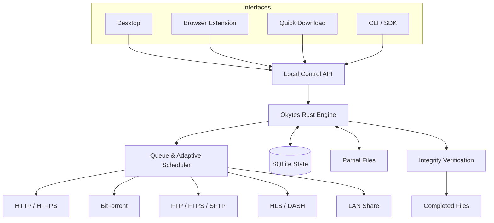

# Okytes


**A download manager built to finish what it starts.**

Recoverable downloads, verified files, and control over your bandwidth. Free, open source, and fully local.


[](LICENSE)

[](https://github.com/dippendicular/okytes/actions/workflows/ci.yml)
[](https://github.com/dippendicular/okytes/releases)

[Downloads](https://github.com/dippendicular/okytes/releases) · [Features](#features) · [Why Okytes](#why-okytes) · [Compare](#okytes-vs-idm-vs-fdm) · [Architecture](#how-it-works) · [Contribute](#contributing)

---

## Why Okytes

A fast download means little if the file ends up corrupted or you have to start over after a crash.

Okytes saves progress safely and checks files before marking them complete. Its parallel-transfer scheduler measures the effect of extra workers and keeps more only when the measured gain justifies them.

| What matters | How Okytes handles it |
|---|---|
| **Crash-safe recovery** | Only committed bytes count as saved progress. Resume from the last durable checkpoint after an interruption. |
| **Safe resume** | Checks the remote file before continuing. If the source has changed, Okytes won't silently combine two versions. |
| **Verified downloads** | Calculates SHA-256, checks an expected hash when provided, and publishes the completed file after validation. |
| **Adaptive acceleration** | Adjusts connections based on measured throughput instead of blindly opening more workers. |
| **One shared engine** | Desktop, browser, CLI, and API clients work with the same Rust engine and download queue. |
| **Free and private** | No ads, subscriptions, license keys, required accounts, or default telemetry. |

No artificial speed limits. No trial expiry. Just a download manager that does its job.

## Features

### Download

- **HTTP/HTTPS:** Parallel byte-range downloads, dynamic work allocation, retry with backoff, and server-aware throttling.
- **BitTorrent:** Magnet links, DHT, trackers, selective downloads, piece verification, and configurable seeding.
- **FTP/FTPS/SFTP:** Browse remote directories, upload and download files, and resume transfers where supported.
- **HLS/DASH:** Download supported unprotected media streams with quality, audio, and subtitle selection.
- **LAN Share:** Send files and complete folders directly to one or more paired devices over authenticated, encrypted local connections. Transfers support receiver approval, durable resume, integrity verification, progress, and discovery with manual-address fallback. See [LAN Share](docs/LAN-SHARE.md).

### Manage

- Persistent download queue with priorities, scheduling, and bandwidth limits.
- Pause, resume, retry, cancel, and batch downloads.
- Drag-and-drop links, duplicate detection, and file conflict handling.
- Searchable history, filters, notifications, and system tray controls.
- Detailed transfer diagnostics, including worker activity, byte ranges, retries, speed, and errors.

### Integrate

- Browser extensions for Chrome, Edge, Brave, Opera, Vivaldi, and Firefox.
- Local Quick Download page for links missed by browser interception.
- Command-line interface with JSON output for scripts and automation.
- Optional background daemon with an authenticated local API.
- Shared transfer infrastructure for desktop, browser, CLI, and future SDK integrations.

Okytes is being built in milestones. Features listed here describe the product scope and may not all be available in the current release.

## Install

Download the latest available build from [GitHub Releases](https://github.com/dippendicular/okytes/releases).

| Platform | Target packages |
|---|---|
| **Windows** x64, ARM64 | `.exe`, `.msi`, portable builds |
| **Linux** x86_64, ARM64 | AppImage, `.deb`, `.rpm` |
| **macOS** Apple Silicon, Intel | `.dmg` |

Release packages, architectures, checksums, and signatures will be listed with each published release. Availability depends on the release stage.

## Quick start

### Desktop

Open Okytes, paste a download URL, or drag links into the application. Manage transfers from the download queue.

### CLI

The CLI workflow is designed for both interactive use and automation.

```bash
# Add a download
okytes add https://example.com/big-file.iso

# Download with an expected SHA-256 checksum
okytes add --sha256 <hash> https://example.com/big-file.iso

# View downloads
okytes list

# Check progress and diagnostics
okytes status <id>

# Pause or resume
okytes pause <id>
okytes resume <id>

# Machine-readable output
okytes list --json
```

CLI commands and flags may evolve before the stable release.

### Browser

Browser extensions hand supported downloads to the native engine. When interception is unavailable, the browser can continue using its own download handling.

If a link is missed, use **Open Quick Download** in the attached desktop app or
`okytes-cli quick --open` with your daemon connection configured. This opens the
correct local address. A daemon configured on port 65432 serves:

`http://127.0.0.1:65432/quick`

Enter the one-use approval code from the trusted desktop or CLI, paste a direct
HTTP/HTTPS link, and download through the installed Rust engine. The page shows
the shared queue, progress, retries, and pause/resume/cancel and priority controls.

Quick Download requires the local daemon to be running with `--quick`; see the
[setup instructions](INSTALLATION.md#quick-download-in-a-local-browser). Transfers
continue after the tab closes while that daemon runs. Pair each new or reloaded
tab again. Links that depend on browser cookies or expired site tokens may need
the extension or a fresh direct URL.

## How it works


One Rust engine manages transfers, state, recovery, and verification. Desktop apps, browser extensions, and other interfaces are clients, not separate download engines.



### Adaptive parallel downloading


Eligible files are split into non-overlapping byte ranges. Workers download those ranges concurrently, while the scheduler measures throughput and adjusts concurrency within resource and server limits.

When a worker slows down, the engine can redistribute unfinished work without overlapping writes.

More connections are useful only when they actually improve throughput.

The [benchmark harness](benchmarks/README.md) compares adaptive transfers with a fixed-concurrency control, with raw results and variance. Performance depends on the workload; calibration and server throttling can make fewer workers preferable.

### Bandwidth and schedules

Set a total bandwidth limit, a separate limit for each download, or recurring windows in your chosen timezone. Windows can lower bandwidth or hold the queue until a quieter time. Preferences survive restarts, and a schedule opening preserves downloads you paused yourself.

### BitTorrent and magnet links

Add a `.torrent` file or paste a magnet link, inspect its files, and choose what to download. Torrent jobs share the queue, history and total download limit with HTTP transfers. A separate BitTorrent engine handles peers and pieces; a piece is recorded in SQLite only after its data is verified and synchronized to disk. Completed jobs publish selected files in their own destination folder.

Sharing can happen while downloading. Seeding stops at completion by default; you can set a time limit, a maximum upload ratio, or both. DHT, peer exchange and local discovery are separate choices and default to off. Peers and trackers can see your IP address and torrent activity. Peer traffic uses plaintext TCP; the optional SOCKS5 proxy covers outgoing peer connections rather than trackers or discovery.

Diagnostics show durable pieces, peers, recorded uploads and configured trackers. Metadata is bounded to 512 KiB, 64 files and 16,384 pieces, with portable ASCII paths; v2 and hybrid torrents are unsupported. Use only material you are entitled to access or distribute.

### Crash-safe checkpoints

Download progress follows a strict persistence order:

```text
Write bytes
    |
    v
Sync data to disk
    |
    v
Commit checkpoint to SQLite
    |
    v
Report durable progress
```

After an unexpected shutdown, Okytes resumes from committed progress. Bytes written but not checkpointed can be downloaded again safely.

### Safe resume

An offset alone cannot prove that a partial file still matches its source.

Okytes checks remote validators, including strong ETags when available, and validates HTTP range responses before resuming.

If the engine cannot establish a safe resume point, it takes a conservative recovery path instead of risking a mixed file.

### Verify before publishing

Once a transfer finishes, Okytes calculates SHA-256 and compares it with a trusted expected checksum when one is supplied.

The file is published only after the required completion checks pass. An automatically calculated hash provides a useful file fingerprint, but does not by itself prove that a remote source is trustworthy.

## Okytes vs IDM vs FDM

IDM and FDM are established download managers with mature acceleration and recovery features. Okytes doesn't reinvent segmented downloading. It approaches the same problems with a shared Rust engine, explicit recovery rules, and open-source development.

| | **Okytes** | **IDM** | **FDM** |
|---|---|---|---|
| **Pricing** | Free | Paid license | Free |
| **Source code** | Open source | Proprietary | Varies by version |
| **Desktop platforms** | Windows, Linux, macOS target | Windows | Windows, Linux, macOS |
| **Download acceleration** | Adaptive byte-range workers | Dynamic segmentation | Parallel connections |
| **Resume** | Durable checkpoints and source validation | Resume and recovery | Resume and recovery |
| **Checksum handling** | SHA-256 with optional expected-hash verification | Depends on workflow | Depends on workflow |
| **BitTorrent** | v1 torrents, magnets, DHT, selective files and seeding limits | Not a primary feature | Supported |
| **FTP/SFTP** | Planned server transfers | FTP support | FTP support |
| **LAN Share** | Encrypted direct file and folder transfer with pairing, receiver approval, discovery, integrity checks and durable resume | No built-in LAN transfer | No built-in LAN transfer |
| **Automation** | CLI and local API | Command-line integration | Remote-control features |
| **Architecture** | Shared Rust engine | Windows-focused application | Cross-platform application |

Okytes is not claiming to outperform IDM or FDM on every download. Speed depends on server limits, network conditions, latency, and disk performance.

The goal is straightforward: use the available bandwidth well without sacrificing file integrity or recoverability.

## Protocols


Different protocols need different transfer strategies. Okytes keeps protocol-specific behavior in separate adapters while sharing queue management, progress reporting, resource limits, and persistence infrastructure.

| Protocol | Capabilities |
|---|---|
| **HTTP/HTTPS** | Byte-range transfers, redirects, TLS validation, adaptive concurrency, validator-aware resume |
| **BitTorrent / Magnet** | Peer discovery, DHT, trackers, selective files, piece verification, seeding controls |
| **FTP / FTPS / SFTP** | Resumable downloads, memory-only login, strict SFTP host-key verification |
| **HLS / DASH** | VOD quality/audio selection, AES-128 HLS, durable segment assembly and WebVTT sidecars |
| **LAN Share** | Device discovery, pairing, receiver approval, encrypted direct transfers |

SFTP runs over SSH. FTPS uses FTP secured with TLS. Their authentication and transfer behavior are handled independently. FTP and explicit FTPS use passive transfers and REST offsets; SFTP uses file offsets. Resumes check the remote size and modification time. Unknown SSH keys require a verified fingerprint confirmation, and changed keys are refused.

HLS and static, single-period DASH downloads preserve source segments in MPEG-TS or fragmented MP4. Video, audio and subtitle selections produce separate files. WebVTT sidecars preserve absolute cue timestamps. Standard AES-128 HLS keys are supported when the authorized manifest supplies them. DRM, live streams, timestamp-mapped subtitles and layouts requiring remuxing are refused.

## Security and privacy

Downloads often involve private URLs, credentials, and untrusted filenames. Okytes treats them accordingly.

- Validate TLS certificates and SSH host identities.
- Keep sensitive credentials out of logs and persistent transfer metadata.
- Avoid storing browser cookies and authorization headers by default.
- Validate paths against directory traversal and unsafe filesystem operations.
- Authenticate local API requests and restrict access to authorized clients.
- Protect localhost interfaces against cross-origin attacks and DNS rebinding.
- Keep remote API access disabled by default.
- Verify update signatures before installation.
- Require receiver approval for incoming LAN transfers.
- Never require a cloud account, hosted relay, or telemetry service.

Security controls are implemented and validated as their respective features are delivered.

To report a security issue, contact the maintainers privately rather than publishing exploit details in a public issue.

## Contributing

Okytes is built with Rust and organized around reusable components. The transfer engine remains independent of desktop interfaces, browser extensions, and other clients.

```text
crates/
    Core engine
    Protocol adapters
    Persistence
    Shared services

apps/
    CLI
    Desktop
    Daemon

extensions/
    Browser integrations
```

### Development checks

```bash
cargo fmt --all -- --check
cargo clippy --workspace --all-targets -- -D warnings
cargo test --workspace
```

Contributions are welcome, especially around transfer reliability, protocol compatibility, performance, accessibility, testing, and documentation.

You can also help by reporting reproducible bugs, suggesting improvements, and testing on different operating systems.

See the [issue tracker](https://github.com/dippendicular/okytes/issues) to get involved.

## License

Okytes is dual-licensed under [Apache-2.0](LICENSE-APACHE) or [MIT](LICENSE-MIT), at your choice.

---

**Own your downloads. Trust the result.**

*Okytes Download Manager*

For a source build, first run `node scripts/prepare-vendor.mjs`. This restores the checksum-pinned torrent dependency patches into the ignored `vendor/` directory.

Installation and removal instructions are in the [installation guide](INSTALLATION.md).
Release artifacts identify their architecture, signing status and installation
verification. Software updates are checked manually from Settings; downloading,
signature verification and installation are separate steps.

For source builds and contributions, see [CONTRIBUTING.md](CONTRIBUTING.md).
Please report vulnerabilities through the [security disclosure process](SECURITY.md).
