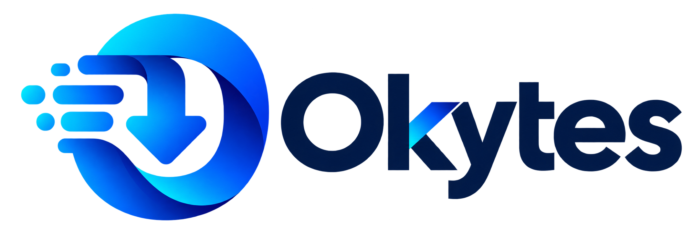

# Okytes desktop



The desktop app runs the HTTP engine in-process and stores its download history
and settings in SQLite. Closing or force-quitting the app leaves durable checkpoints
for recovery on the next launch. The CLI and desktop may control the same database,
but only one process can own transfer writes.

Use **Add downloads** for one link or a batch of up to 100 links. Paste from the
clipboard, import a text file, or drop links onto the window. Search by filename,
URL or destination, and filter by file category or download state. Pause a job
before renaming it. **Download again** creates a fresh entry and preserves existing
files; **Remove from history** leaves completed files on disk.

Details show durable segment checkpoints, validators, retry counts, the last
engine error, and session HTTP response diagnostics. The speed graph measures
changes in durable downloaded bytes. Settings control the default folder,
simultaneous downloads, appearance and native notifications. The tray offers
show/hide, pause-all and quit.

## New in 0.0.2

### Download window

**Details** on a row opens a separate window for that download. A second click
brings the existing window forward. It has three tabs:

- **Download status:** URL, status, size, downloaded and percentage, transfer
  rate, time left, resume capability, progress, and Resume / Pause / Cancel.
  **Hide details** collapses the lower part. Expanded, it shows:
  - **File map:** the whole file as one bar. Completed, downloading, stalled
    (no data for 5 seconds), retrying, failed and pending ranges have distinct
    colours. It is drawn on a canvas, so very large or highly split files stay fast.
    Files of unknown size show a single stream instead.
  - **Connections:** each live request with its segment, byte range, bytes
    received, speed, retries and status. Segments are durable byte ranges; a
    connection is one transient request serving part of a segment.
  - **Replace link:** for a failed download (see [Expired links](#expired-links)).
- **Speed limiter:** use the default per-download limit, no limit, or a custom
  KiB/s limit for this download only. The global limit still caps the total.
- **Options on completion:** open the file, show it in its folder, show a
  notification, and upload to a connected cloud storage provider. These run in
  the app even after the window is closed, and only once.

Settings → **Open a download window when a download starts** opens it
automatically. The in-app details dialog (click the file name) remains for
rename, priority, history and full diagnostics: response status and time,
range support, ETag, Last-Modified, concurrency, retries, last error and
SHA-256 verification.

Live connection data comes from the built-in engine, or from the daemon's
`/v1/jobs/{id}/telemetry` route when the desktop is attached to a daemon.

### Expired links

Signed and time-limited links often stop working mid-download (HTTP 401, 403
or 410, or a web page instead of the file). Okytes now stops with a clear error
instead of saving the page as your file. To continue:

1. Get a fresh link to the same file (for example, start the download again in
   the browser and copy its link).
2. In the download window choose **Refresh link and resume**, or in the details
   dialog use **Replace link** and then **Resume**.

Okytes checks that the new link serves the same file (strong ETag, or size and
modification date) and keeps every completed segment. A different file is
refused; use **Download again** instead. Browser session cookies are dropped
when the new link is on a different site.

### Batch patterns, start times and finish actions

- **Batch pattern.** In **Add downloads**, a link such as
  `https://example.com/file[001-100].zip` adds the whole series. `[1-20]`,
  zero-padded `[001-100]`, stepped `[0-100:10]` and `[a-f]` work, up to 100
  links per import.
- **Start at.** Click a download's name to open its details, choose a date and
  time and select **Schedule start**. The download stays paused until then.
  Okytes must be running at that time, and it does not wake a sleeping
  computer. A time that passed while Okytes was closed starts the download
  when Okytes opens.
- **When downloads finish** (Settings). Okytes can put the computer to sleep,
  shut it down, or quit after every download has finished. The choice applies
  once and is forgotten when Okytes closes. Okytes shows a notice for 60
  seconds first; **Cancel** stops it. Paused and failed downloads do not count
  as unfinished, and a download with a start time keeps the computer on.
- **Extract archives** (Settings, off by default). A finished zip, 7z or tar
  archive is unpacked into a new folder beside it with the system's `tar`
  (`bsdtar` or `unzip` on Linux). Existing files are never overwritten.

### Website crawler

**Crawl website** collects file links from a site:

- Follows links 0–3 levels deep on the same site, visiting up to 200 pages.
- Filters by file type, and can include files hosted on other sites.
- Honours `robots.txt`, fetches one page at a time with a short pause, and
  scans at most 2 MiB per page.

Results are grouped by type. Review them and choose **Add selected**; nothing
downloads automatically.

### Playlists and media merging

- **Expand playlist** (Add downloads, one link) replaces an M3U, PLS or XSPF
  playlist link with up to 100 of the links it lists, for review. HLS streams
  are refused here; use **Add media** for them.
- In **Add media**, when you select a video track plus audio or subtitle tracks,
  **Merge … into one MKV** combines them after all finish. Merging uses
  [ffmpeg](https://ffmpeg.org) and copies streams without re-encoding, so it is
  fast and lossless. The separate tracks are kept. ffmpeg must be on `PATH`, or
  set `OKYTES_FFMPEG` to its full path. Pending merges survive a restart.

### ZIP preview

**Preview ZIP contents** (Add downloads, one link) lists the files inside a
remote ZIP without downloading it: names, sizes, compression method, encrypted
entries, dates and the archive comment. It reads only the end of the archive
and its file index with byte-range requests, and supports ZIP64. The server
must support range requests. At most 5,000 entries are listed.

### Okytes Cloud

**Settings → Okytes Cloud** pairs this computer with your self-hosted
[okytes-cloud](../cloud/README.md) server: links sent from the dashboard or your
phone start here, and history syncs both ways. **Downloads on my other devices**
lists what your other computers downloaded, with **Download here**.

### Cloud storage uploads

**Settings → Cloud storage** connects Google Drive, Dropbox and OneDrive. Okytes
does not ship shared API keys; register a free app with each provider and enter
its client ID:

| Provider | Register at | Settings |
|---|---|---|
| Google Drive | Google Cloud Console → enable the Google Drive API → Credentials → OAuth client ID, type **Desktop app** | Enter the client ID and client secret. Scope used: `drive.file` (only files Okytes creates). |
| Dropbox | Dropbox App Console → Create app (Scoped access) → Permissions: `files.content.write` | Enter the app key as the client ID. |
| OneDrive | Microsoft Entra admin center → App registrations → New registration, personal Microsoft accounts allowed → Authentication → Mobile and desktop applications | Enter the application (client) ID. Scopes used: `Files.ReadWrite offline_access`. |

Add the redirect URI `http://127.0.0.1:17901/callback` to each app. Choose
**Sign in…**; your browser opens, and Okytes listens once on that local port.

Uploads go to an `Okytes` folder, in resumable 10 MiB chunks. A failed chunk is
retried up to four times; Drive and OneDrive resume from the bytes the provider
confirms. Progress shows at the bottom of the main window, and a notification
reports success or failure. Refresh tokens are stored as owner-only files in the
Okytes profile; **Disconnect** deletes them. Also remove Okytes from your
account's connected apps to revoke access fully.

## Running from source

Install the pinned Rust toolchain, Node.js 24, pnpm 11 and the platform prerequisites
listed in the [Tauri documentation](https://v2.tauri.app/start/prerequisites/).
On Windows, this includes the MSVC build tools and WebView2 runtime.

From `apps/desktop`:

```sh
pnpm install --frozen-lockfile
pnpm tauri dev
```

Build a local executable without an installer:

```sh
pnpm tauri build --no-bundle
```

Use `--debug` for a development executable. From the repository root, run the
Rust workspace checks and `cargo test -p okytes-core --lib` to regenerate the
TypeScript bindings. Frontend checks are `pnpm format:check`, `pnpm typecheck`, `pnpm lint`, and
`pnpm test`; `pnpm build` produces local web assets.

The app normally stores its database under the platform application-data folder.
`OKYTES_DATA_DIR` and `OKYTES_DOWNLOAD_DIR` accept absolute paths for an isolated
profile. They are process environment settings, not webview filesystem access.

## Windows native integration test

Build the debug app and the deterministic fault-server fixture:

```sh
pnpm tauri build --debug --no-bundle
cargo build -p okytes-test-support --example desktop_fixture
node scripts/native-e2e.mjs
```

The test attaches Playwright to the actual WebView2 instance, uses an isolated
profile, and writes evidence under the ignored `.tools` directory. It enables a
loopback debugging port only in that test process. It does not expose a management
API in normal application runs. Other platforms require their own native tests.
