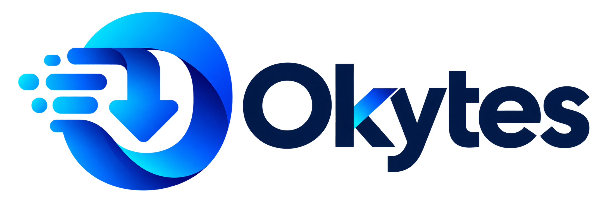

# Okytes browser integration

## Download a built extension

GitHub Releases package `Okytes-Chrome-extension.zip` with compiled browser files.
Users do not need build tools. Follow [the installation guide](INSTALLATION.md)
or the release's `BROWSER-INSTALLATION.md`. This distribution still requires
Chrome Developer mode; the desktop registers its bundled native host on launch.
Store publication is a separate step.



Browser integration requires the running Okytes desktop app and its separately
registered native host. The host forwards captures over authenticated per-user
IPC; it does not run downloads. Closing the browser or killing its host after
acceptance leaves the desktop transfer running.

## Build

From the repository root:

```sh
cargo build -p okytes-native-host --locked
cargo test -p okytes-browser-bridge --lib --locked
```

The bridge's Rust tests regenerate the shared TypeScript protocol definitions.
From `extensions`:

```sh
pnpm install --frozen-lockfile
pnpm typecheck
pnpm lint
pnpm test
pnpm build
```

Load `extensions/dist/chromium` through **Load unpacked** on the browser's extension
management page. In Firefox use **about:debugging → This Firefox → Load Temporary
Add-on**, selecting `extensions/dist/firefox/manifest.json`. Temporary Firefox
installation lasts for that browser session; signing/store distribution is separate.

## Native-host registration

Released desktop packages register their bundled native host automatically on
every launch. The packaged Chromium extension has the fixed ID
`lodlcbjagldkbkplgkhmhklfgpbgmpfb`, which the desktop allowlists together with
the Firefox ID `okytes@okytes.org`.

The manual command below is only needed for development builds or a deliberately
changed extension ID.

Keep the built executable in a stable location. The manifest records its absolute
path, so moving it requires re-running installation. On Windows:

```powershell
.\target\debug\okytes-native-host.exe install --chromium-id YOUR_32_CHARACTER_EXTENSION_ID
```

On Linux/macOS:

```sh
./target/debug/okytes-native-host install --chromium-id YOUR_32_CHARACTER_EXTENSION_ID
```

Repeat `--chromium-id` for distinct unpacked, Chrome Web Store or Edge Add-ons IDs.
Obtain the actual ID from the browser; no wildcard origin is accepted. Firefox
uses `okytes@okytes.org` by default, matching its manifest. `--firefox-id` overrides
registration for a deliberately changed Firefox manifest ID.

Installation creates a private token in the desktop profile and per-user host
manifests. It registers HKCU Chrome/Edge/Mozilla keys on Windows, Chrome/Chromium
and Mozilla user paths on Linux, and Chrome/Edge/Mozilla Application Support paths
on macOS. Custom Linux browser configuration paths and additional Chromium brands
may need the generated manifest copied to that browser's native-host directory.

Restart Okytes after provisioning the host. Desktop and host must use the same
profile. Their defaults use `org.okytes.desktop` in platform application data;
`OKYTES_DATA_DIR` can select an absolute custom profile. For a browser-spawned host
to inherit that override, launch the test browser from the same environment.

## Use

Open the extension popup to send one link or collect up to 100 page links for
review. Link/file context-menu capture falls back to a browser download if Okytes
is unavailable. Page collection through its context-menu action sends a bounded
batch; popup collection provides review before sending.

Configure automatic capture through Settings. Deny domains take precedence over
allow domains; domain matching includes proper subdomains, not substring matches.
Type rules use filename extensions. Unknown sizes bypass size-constrained rules.
All automatic capture skips private browsing and extension-created downloads.

**Allow this site** grants optional session/request access for one origin. Reload
the page to enable Alt-click bypass. Cookies and allowlisted observed headers are
handed off in memory for one job. A desktop restart loses those session values;
credential-bearing jobs then require a new browser capture. A plain unauthenticated
job retains normal crash recovery.

Media detection lists candidate `.m3u8` and `.mpd` URLs. Review them and use
**Send to Okytes** to create HLS/DASH jobs. Okytes validates the manifest and
selected segments, supports VOD and authorized AES-128 HLS, and refuses DRM,
live streams and unsupported assembly formats. Automatic ordinary URL capture
does not reinterpret arbitrary files as media.
Required permissions cover native messaging, downloads, menus, rule storage and
user-selected tab scripting. Cookies and request observation require optional
site access; there is no required blanket host grant.

## Verification limits

Rust and mocked-browser tests cover protocol validation, authentication, replay,
bounded framing, durable handoff, disconnect isolation and fallback. Native
browser results and tested versions are recorded in the M3 report; building a
manifest alone does not establish browser compatibility. Safari, store publication
and platform installers/signing are outside this milestone.

On Windows, build the desktop and `desktop_fixture` example, then run
`node scripts/chrome-e2e.mjs` from this directory for installed-Chrome verification.
The script uses an isolated profile and temporary per-user native-host registration,
backs up existing keys and restores them afterward. It enables unsafe extension
debugging only in that test browser process. `OKYTES_CHROME` selects a different
Chrome executable. The Rust protocol source is
[protocol.rs](../crates/browser-bridge/src/protocol.rs).
